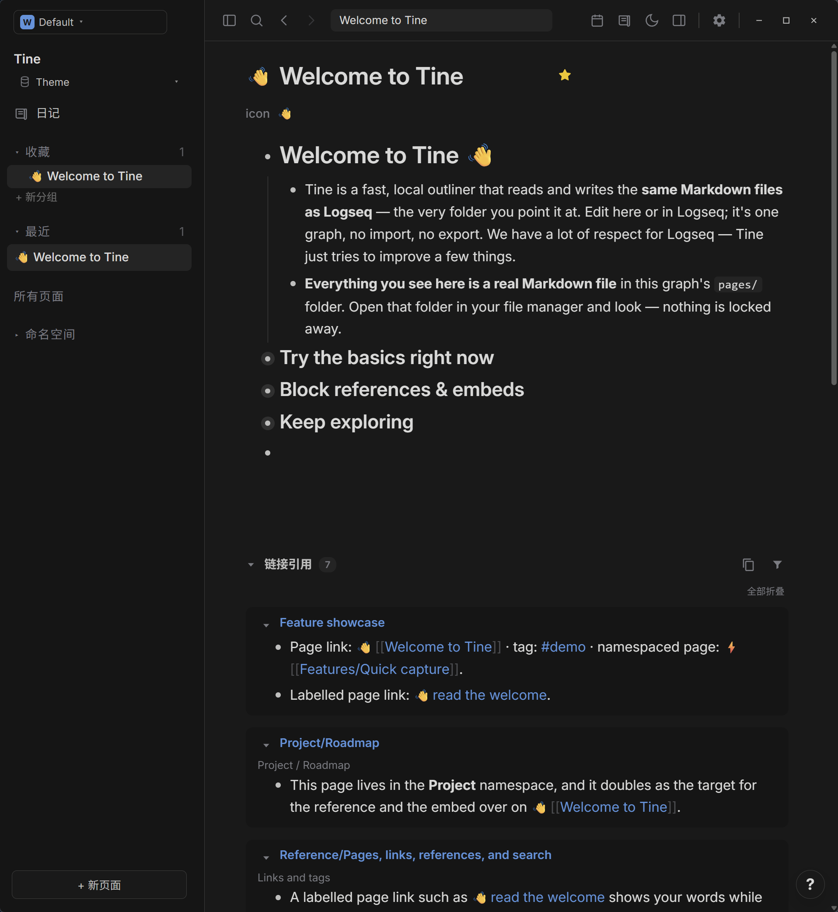
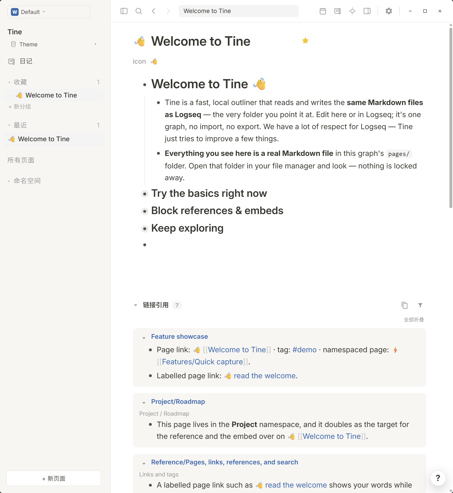

# Notion · Prism

**柔和纸色与安静的影子，让想法从容展开。**

[English](README.md) · [下载 theme.json](https://github.com/EllisMorrow/tine-theme-notion-prism/releases/latest/download/theme.json)

Notion · Prism 以 Notion 预设为视觉参考，配对浅色与深色阅读色板，并独立适配 Tine 的背景、链接和高亮。

### 深色模式

### 浅色模式

*用户测试后提供的 Windows 实机截图，两套配色均实际包含在同一个主题包中。*

## 安装

1. 下载 [theme.json](https://github.com/EllisMorrow/tine-theme-notion-prism/releases/latest/download/theme.json)。
2. 在 Tine 打开 **设置 → 外观 → 主题包 → 选择 theme.json**，选择下载的文件。
3. 点击 **使用颜色**，选择 **浅色、深色或跟随系统**。

需要主题 API **0.2** 支持。原有 `logseq/custom.css` 和设备强调色可能影响效果；主题只负责 API 支持的颜色，不包含额外字体、布局或任务标记样式。

## 配色

| 角色 | 浅色 | 深色 |
| --- | --- | --- |
| 主背景 | `#ffffff` | `#191919` |
| 侧栏 | `#f7f6f3` | `#151515` |
| 正文 | `#37352f` | `#d9d9d8` |
| 标题 | `#37352f` | `#d9d9d8` |
| 强调色 | `#3183d8` | `#3183d8` |
| 链接 | `#2a6aaf` | `#4e94dd` |
| 标签 | `#2a6aaf` | `#4e94dd` |
| 高亮底色 | `#e6f0fa` | `#1c2630` |

## 验证情况

通过官方主题格式检查；浏览器样例检查了两套完整变量、模式切换及指定颜色组合。用户提供了上方 Windows 明暗实机截图，展示公开欢迎页面上的标题、正文、层级、链接、标签、行内代码和引用区域。高亮、选中操作、设置状态和其它平台未由这些截图覆盖，不据此宣称全部路径均已验证。

## 来源与边界

视觉参考：[Codex Notion appearance preset](https://learn.chatgpt.com/docs/reference/settings#appearance)，`installed version 26.1021.3705`。本独立编写的适配采用 MIT 许可；详见 [许可说明](LICENSE)。仅参考本机 Codex 预设的部分可见颜色，不分发 Codex 源代码或资源。原参考只有单模式时，另一模式为独立生成的待验收适配；公开前仍需核对原始来源和署名。

独立社区适配由 EllisMorrow 完成，使用 AI 辅助开发。不分发 Codex 程序代码、标志或附带资源，不代表相关项目或 OpenAI 的官方产品，也不承诺与 Codex 像素级一致。具体映射和验证边界见 [适配说明](docs/adaptation.md)。

顶部徽标统计 GitHub Release 附件累计下载量，不代表安装人数。可在本仓库反馈问题，附版本、系统、模式及不包含私人内容的截图。
